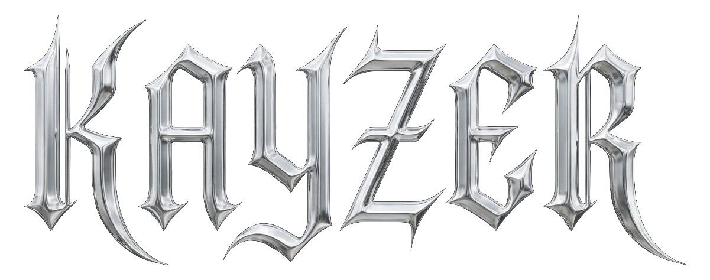
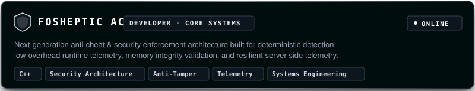

  <!-- ==================== 3D CHROME GOTHIC LOGO ==================== -->
  

  <!-- Subtitle -->
  

    ANTI-CHEAT &amp; KERNEL SECURITY ARCHITECTURE
  

  <!-- Metallic Monochrome Badges -->
  

    
    
    
  

  <!-- Divider -->
  

    <code>━━━━━━━━━━━━━━━━━━━━━━ ❖ ━━━━━━━━━━━━━━━━━━━━━━</code>
  

### ▎ `[01]` // KERNEL.TELEMETRY

  

 

  <code>━━━━━━━━━━━━━━━━━━━━━━ ❖ ━━━━━━━━━━━━━━━━━━━━━━</code>

### ▎ `[02]` // LIVE.PRESENCE

  <!-- Discord & Spotify Live Presence (ID: 565937208192925736) -->
  

 

  <code>━━━━━━━━━━━━━━━━━━━━━━ ❖ ━━━━━━━━━━━━━━━━━━━━━━</code>

### ▎ `[03]` // TECH.ARSENAL

  <!-- LANGUAGES (Metallic Monochrome) -->
  
<code>// LANGUAGES</code>

  

    
    
    
    
    
    
    
    
  

  <!-- SYSTEMS · RUNTIME · LOW-LEVEL -->
  
<code>// RUNTIME &amp; KERNEL FRAMEWORKS</code>

  

    
    
    
    
    
  

  <!-- INFRASTRUCTURE · STORAGE & TOOLING -->
  
<code>// INFRASTRUCTURE &amp; SECURITY TOOLING</code>

  

    
    
    
    
    
    
  

 

  <code>━━━━━━━━━━━━━━━━━━━━━━ ❖ ━━━━━━━━━━━━━━━━━━━━━━</code>

### ▎ `[04]` // FEATURED.SYSTEM

<!-- Sadece FOSHEPTIC AC -->

  

 

  <code>━━━━━━━━━━━━━━━━━━━━━━ ❖ ━━━━━━━━━━━━━━━━━━━━━━</code>

### ▎ `[05]` // GITHUB.TELEMETRY

  <!-- Full Monochrome Black & Silver Telemetry Cards -->
  
  &nbsp;
  

    

  

